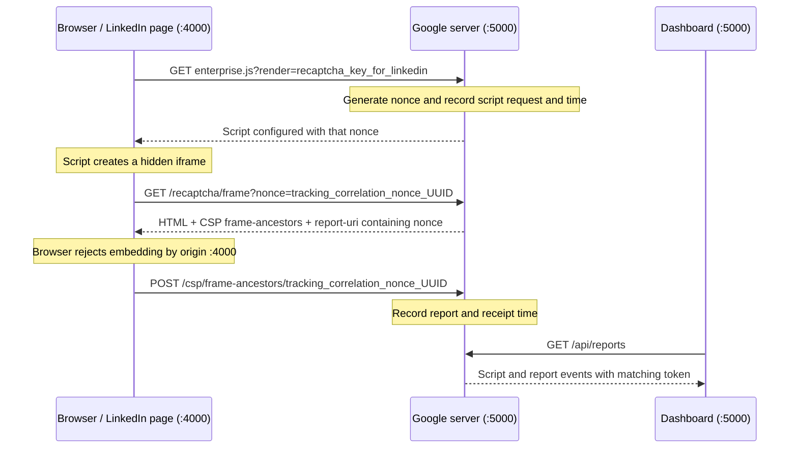

# CSP Reporting as Telemetry

A local demonstration of how a browser-generated Content Security Policy (CSP) violation report can become an additional telemetry signal, correlated with an earlier script request.

Two local servers play the roles of **LinkedIn**, which embeds a third-party script, and **Google**, which serves the script and receives the resulting report. No requests are made to LinkedIn or Google. The script is a small simulation, not the real reCAPTCHA library.

## Background: an observation from March 2026

In March 2026, I observed CSP violation reporting while inspecting Google reCAPTCHA integration on LinkedIn. A third-party resource flow resulted in a browser-generated report being sent back to Google.

My interpretation was that CSP reporting provided Google with an additional signal: beyond receiving the initial resource request, it could receive a later notification associated with browser processing of the embedded document. Timing and request metadata could then be correlated.

This repository makes that mechanism visible and reproducible locally. The nonce format, client key, endpoints, and dashboard are explicit demonstration choices. They do not reconstruct Google's internal implementation or establish how Google used the signal in a reCAPTCHA risk score. The March observation is historical; the same behavior need not be visible on LinkedIn today.

## Run the demo

Requires Node.js 18 or later and npm.

```sh
npm ci
npm start
```

Open **http://localhost:5000/dashboard**, then click **Open demo**.

| Address | Role |
| --- | --- |
| `http://localhost:4000/` | Simulated LinkedIn page that loads the third-party script |
| `http://localhost:5000/dashboard` | Google telemetry dashboard; also available at `/` |
| `http://localhost:5000/recaptcha/enterprise.js?render=recaptcha_key_for_linkedin` | Simulated reCAPTCHA script |
| `http://localhost:5000/recaptcha/frame?nonce=<token>` | Framed document with the CSP policy |
| `http://localhost:5000/csp/frame-ancestors/<token>` | Browser report collector |

The dashboard refreshes every two seconds. Each card groups one script request and the reports carrying the same nonce. Both the script event and report details are expanded by default. Use **Clear events** to start a fresh run.

## The mechanism, step by step



### 1. A script request identifies the integration

The LinkedIn page loads a classic script from the Google server. Its `render` parameter contains `recaptcha_key_for_linkedin`, a readable placeholder for an integration's site key.

Google records the client key, HTTP referrer, source IP, User-Agent, and server timestamp. It also generates a random UUID prefixed with `tracking_correlation_nonce_` and stores it in the event's `token` field.

### 2. The script carries the nonce into an iframe

The returned script creates a hidden iframe pointing to:

```text
http://localhost:5000/recaptcha/frame?nonce=tracking_correlation_nonce_<UUID>
```

The script and iframe responses use `Cache-Control: no-store`. Each new script request therefore gets its own correlation token instead of reusing a cached response.

### 3. The iframe document deliberately rejects its parent

The **iframe document's response** carries this header:

```http
Content-Security-Policy: frame-ancestors 'self' localhost:5000; report-uri http://localhost:5000/csp/frame-ancestors/tracking_correlation_nonce_<UUID>
```

Origins include the port. The Google document on port 5000 cannot be embedded by the LinkedIn page on port 4000 under this policy.

The browser blocks the document from being displayed inside the iframe and reports the violation. The iframe element remains in the page, and the parent page continues working. Blocking is intentional: the report is the result this demo wants to observe.

This is an **enforced** policy, not a report-only policy. Reports should contain `disposition: "enforce"`. Putting the policy on the script response would not establish the iframe document's embedding policy.

### 4. The browser sends a second, correlated request

The browser sends a POST to the `report-uri` endpoint with an `application/csp-report` body. The page's JavaScript does not explicitly send that POST.

The collector reads the token from the request path and stores it alongside the report. It does not depend on the browser preserving the nonce in `document-uri` or `blocked-uri`; browsers can reduce cross-origin URL details.

### 5. The dashboard joins GET and POST by nonce

```text
Script GET ---- shared nonce ----> CSP report POST
   t0                                  t1
                  elapsed = t1 - t0
```

The dashboard groups events by their exact token, even when reports from multiple tabs arrive out of order. It shows the client key, shared token, and elapsed time to the first matched report. Several reports can belong to the same script request.

Elapsed time combines resource loading, browser processing, report scheduling, and network delays. It is a server-observed interval, not a measurement of script execution time. IP is recorded as metadata; matching uses the nonce, not the IP. Events without a matching stored script remain visible without a calculated interval.

## What information reaches the collector?

| Information | Initial script GET | Report POST |
| --- | --- | --- |
| Integration/site key | In the request URL | Recovered by joining the nonce to the script event |
| Correlation token | Generated by the server | Returned in the collector URL |
| Source IP and User-Agent | Recorded | Recorded |
| HTTP referrer | Recorded if present | Recorded if present |
| Server-side timing | Script serving timestamp | Report receipt timestamp |
| CSP violation details | Not yet available | Directive, policy, disposition, document URL, and other browser-provided fields |

The extra signal is the later event: something followed the resource flow far enough to encounter the iframe's embedding policy and return a matching report. This can be useful telemetry in an anti-bot context, but does not prove a human is present. Automated browsers can produce genuine reports, and a client can forge a report POST. The nonce is a correlation identifier, not a secret or authentication token.

The report does not, by itself, transmit the LinkedIn page's text, form contents, or browsing history. A missing report alone does not identify a blocker or establish that a client is automated.

### Reading the JSON

- Outer `referrer`: captured by the server from the HTTP `Referer` header of that request. This is the value shown in event summaries.
- Inner `report["csp-report"].referrer`: supplied inside the browser's report. It describes a different reporting context and may differ from the HTTP header.
- `violated-directive` / `effective-directive`: the CSP rule involved, here `frame-ancestors`.
- `original-policy`: the document's policy, including its per-request collector URL.
- `disposition: "enforce"`: the browser enforced the policy.
- `script-sample`: normally empty for this violation; embedding a document does not identify an offending inline code fragment.
- `timestamp` / `isoTime`: generated by our server when recording the event, not browser event timestamps.

## Verify it in DevTools

On the LinkedIn demo page, open DevTools, select **Console**, and reload. Example messages:

**Chrome:**

```text
Refused to frame 'http://localhost:5000/' because an ancestor violates the following Content Security Policy directive: "frame-ancestors 'self' localhost:5000".
```

**Brave:**

```text
Framing 'http://localhost:5000/' violates the following Content Security Policy directive: "frame-ancestors 'self' localhost:5000". The request has been blocked.
```

In **Network**, look for the script GET, the iframe GET with its nonce, and the report POST containing the same token in its path. Return to the dashboard to inspect the correlated pair.

Console wording, URL redaction, report delivery, and referrer values vary by browser and privacy settings. If you see a violation without a dashboard report, inspect the report request in Network. A console violation confirms policy enforcement, not successful report delivery.

## Project layout

```text
server.js                 Two Express applications, routes, and event recording
lib/report-store.js       Local JSON persistence; keeps the newest 200 events
lib/recaptcha-script.js   Generates the simulated script with safely serialized configuration
public/linkedin.html      Simulated embedding page
public/dashboard.html     Dashboard markup and explanation
public/dashboard.css      Dashboard styling
public/dashboard.js       Nonce correlation, event rendering, and polling
test/                     HTTP and dashboard regression tests
reports/collected.json    Runtime data; created automatically and ignored by Git
```

The store is intentionally a small, synchronous JSON file for a local demonstration. Old events are removed after the 200-event limit; a report whose script has been removed cannot be paired. Existing local reports are not deleted by a code update.

An optional `/csp/report-to/:token` POST endpoint accepts Reporting API JSON, including `application/reports+json`. The demo flow uses `report-uri`; it does not configure Reporting API delivery.

## Tests

```sh
npm test
```

Tests use temporary report stores and isolated HTTP servers. They do not overwrite your collected events. Browser-generated report delivery is verified manually using the demo and DevTools.

## Scope

This project is a local educational reproduction, not a CAPTCHA service or a production telemetry collector. The two roles and readable client key make the data flow explicit. No real Google or LinkedIn endpoints are contacted, and the repository does not claim access to either service's internal scoring logic.

## License

This project is licensed under the [MIT License](LICENSE).

## References

- [CSP Level 3: frame-ancestors](https://www.w3.org/TR/CSP/#directive-frame-ancestors)
- [CSP Level 3: report-uri](https://www.w3.org/TR/CSP/#directive-report-uri)
- [CSP Level 3: violation report security considerations](https://www.w3.org/TR/CSP/#security-violation-reports)
- [Reporting API](https://www.w3.org/TR/reporting/)
